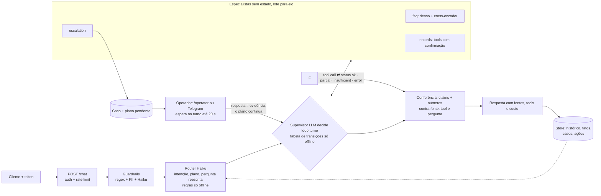

# Getnet Multi-Agent Support

Atendimento multi-agente para lojistas da Getnet: um Router decide, o Knowledge responde com RAG sobre o site oficial (e dado ao vivo de clima e câmbio), o Support lê os dados do próprio cliente por ferramentas e um humano entra só quando nada resolve.

| | |
|---|---|
| Rodar | `docker compose up -d --build` → `http://localhost:8000/docs` · console do operador em `/operator` |
| Testar | `python scripts/check.py --docker --scale` (lint, testes, eval com gate, build, imagem sem extras, smoke do container, 2 réplicas atrás de balanceador) |
| CI | [Actions](../../actions/workflows/ci.yml) (o último commit é só o README; o código é o do commit anterior) |
| Vídeo | [walkthrough na página de Releases](../../releases/tag/video) (MP4 + legendas; narração por IA a partir do roteiro do autor, telas e números reais) |

O que o enunciado pede que o README cubra → onde: build, configure, run and test (§1) · orchestration architecture
(§2) · message workflow (§2.1) · RAG pipeline (§2.2) · design choices (§4) · how LLM tools were used (§5) · testing
strategy (§6).

## 0. Resultado em uma tela

O que o sistema entrega nos cenários do enunciado, medido ao vivo e gerado por `scripts/fill_readme.py` a partir de
`evals/results/` commitado (o `check.py` reprova divergência). As respostas reais de cada cenário oficial, com os
passos que o supervisor escolheu (agente, status, ferramentas, tempo), estão em [docs/DEMO.md](docs/DEMO.md); as
tabelas completas, em [docs/RESULTS.md](docs/RESULTS.md); o que veio do kit, em [docs/PROCEDENCIA.md](docs/PROCEDENCIA.md).

<!-- scorecard:begin -->
| medida | valor | como se mede |
|---|---:|---|
| Oficiais resolvidas (sem humano + todo fato + fonte) | 1.00 | resposta sem humano, com todo fato de referência do cenário e com fonte (os 10 do enunciado) |
| Oficiais resolvidas: pass^k (todas as rodadas) | 1.00 | o mesmo, em todas as rodadas de cada cenário |
| Juiz: respostas oficiais fundamentadas | 1.00 | juiz LLM com o texto das fontes: cada afirmação apoiada nelas |
| Juiz: respostas oficiais úteis (helpful) | 1.00 | juiz LLM: a resposta resolve o que o lojista perguntou |
| Memória ao vivo: pass@1 | 0.95 | conversas de vários turnos: o fato do turno anterior chega à resposta |
| Busca: Recall@3 | 0.81 | perguntas rotuladas olhando a fonte: a página certa entre as 3 primeiras |
| Busca: MRR | 0.78 | posição média da primeira página certa (1 = sempre em primeiro) |
<!-- scorecard:end -->

### 0.1 Mapeamento do desafio

| Requisito do enunciado | Implementação | Onde |
|---|---|---|
| Router Agent: entrada, decide o agente ou a sequência | router LLM (intenção, pergunta completa do turno, buscas) e supervisor LLM que observa cada resultado e decide o próximo passo | `src/app/router.py`, `src/app/supervisor.py` |
| Knowledge Agent: RAG sobre o site + busca para o geral | busca densa + reranker nas páginas oficiais da Getnet, resposta só com fonte citada; clima e câmbio por ferramenta de dado ao vivo | `src/app/rag.py`, `src/app/agents.py`, `data/knowledge/` |
| Customer Support Agent com ≥ 2 tools | `get_settlements`, `get_transactions`, `get_terminal_status`, `request_advance` sobre os dados do próprio lojista (identidade pelo token) | `src/app/domain/challenge/tools.py` |
| Comunicação entre agentes | especialistas como ferramentas do supervisor, passos registrados por turno | `src/app/supervisor.py` (`steps`) |
| `POST` com `{"message", "user_id"}` → JSON | `/chat` | `src/app/api.py` |
| Docker | `docker compose up -d --build` | `Dockerfile`, `docker-compose.yml` |
| Testes e estratégia de integração | §6 | `tests/`, `evals/`, `scripts/check.py` |
| Bônus: 4º agente humano | escalada com consulta ao operador dentro do turno e retomada do plano | `src/app/hitl_sync.py`, `src/app/resume.py` |
| Bônus: guardrails | entrada (injeção, dado de outro cliente, fora do escopo) e saída (número e frase sem base) | `src/app/guardrails.py`, `src/app/grounding.py` |
| Bônus: redirect/handoff | sem fonte ou sem dado → humano, com o motivo | `src/app/supervisor.py` |
| Bônus: avaliação e observabilidade | gabarito por cenário, juiz, traces, métricas e alertas | §6, `src/app/observability.py`, `ops/` |

### 0.2 Teste em 3 minutos

1. `docker compose up -d --build` e abra `http://localhost:8000/docs`.
2. Entre como o lojista de teste (§1, passo Entrar) e mande o 1º cenário oficial (o `curl` do §1).
3. Mande um seguimento curto ("e quanto custa?"): a resposta usa o turno anterior.
4. Pergunte algo que o site não cobre ("Vocês têm maquininha com impressora térmica colorida?"): a resposta diz o que
   a fonte cobre e oferece o atendente; pedido sem fonte vai ao operador, que responde em `/operator`.

Validação humana: rótulos às cegas do dono pela página de rotulagem (2 rodadas; a 2ª com falhas suspeitas na amostra); quantos, a concordância e os limites estão no bloco humano de `docs/RESULTS.md` (gerado).

## 1. How to build, configure, run and test (construir, configurar, rodar e testar)

**Build e run** (sem chave roda no modo offline determinístico):

```bash
cp .env.example .env                      # opcional: chave e modelos; sem ele, offline
docker compose up -d --build              # build multi-stage + API em http://localhost:8000/docs
curl -s localhost:8000/health
```

**Entrar** (usuário e senha → o mesmo JWT de `/chat`; senhas de teste semeadas no próprio ambiente, só o hash fica
em `var/credentials.json`, fora do git):

```bash
docker compose exec app python -m app.auth seed-passwords   # imprime usuário e senha de cada cliente de teste
TOKEN=$(curl -s -X POST localhost:8000/auth/login -H "Content-Type: application/json" \
     -d '{"user_id": "<usuário>", "password": "<senha impressa acima>"}' | python -c 'import json,sys; print(json.load(sys.stdin)["access_token"])')
curl -s -X POST localhost:8000/auth/logout -H "Authorization: Bearer $TOKEN"   # sair: revoga o token
```

**Primeira conversa** (gerado por `scripts/fill_readme.py` a partir do 1º caso do split `official`):

<!-- quickstart:begin -->
```bash
# 1º caso oficial (official-01, evals/cases.jsonl), como o cliente cliente1988, com o $TOKEN do passo Entrar
# (atalho de teste, sem senha: TOKEN=$(python -m app.auth cliente1988))
curl -s -X POST localhost:8000/chat -H "Authorization: Bearer $TOKEN" \
     -H "Content-Type: application/json" -d '{"message": "What'\''s the difference between the Get Clássica and the Get Smart?"}'
```
<!-- quickstart:end -->

**Testar:** `python scripts/check.py` (lint, testes, eval com gate, README ⇔ evidência) ·
`python scripts/check.py --docker --scale` (+ imagem, smoke do container, 2 réplicas atrás de balanceador) ·
`python -m evals.run_evals` (gate offline) · `python -m evals.run_evals --live --splits official,memory --judge
--max-usd 3` (ao vivo, com teto e juiz por split).

**Configurar:**

- **Identidade:** `AUTH_MODE=required` (só Bearer; padrão do compose) ou `demo` (aceita `user_id` do corpo, marca
  `identity_verified=false`, rate limit por IP), ligado só pelo override
  `docker compose -f docker-compose.yml -f docker-compose.demo.yml up` para o payload literal `{"message","user_id"}`.
  Decisão em [docs/adr/0001-auth-mode-demo.md](docs/adr/0001-auth-mode-demo.md). JWT com `kid` e chaves rotacionáveis
  (`AUTH_KEYS`: HS256, EdDSA, RS256; públicas em `GET /.well-known/jwks.json`; `python -m app.auth keygen`).
- **Vários hosts:** `DATABASE_URL=postgresql://...` troca o SQLite por Postgres atrás da mesma interface
  ([ADR 0003](docs/adr/0003-postgres-opcional.md)); `docker compose --profile postgres up -d --build postgres api-pg
  lb-pg` sobe 2 réplicas sem arquivo compartilhado; `scripts/pg_replicas_smoke.py` prova com 2 processos.
- **Operador humano:** `/operator` (token digitado na página, nunca embutido), `GET /handoffs`,
  `POST /handoffs/{id}/reply` com `X-Operator-Token`. A resposta entra como evidência (agente `human`) e os passos
  pendentes do plano rodam na hora. Fila por especialidade (`OPERATOR_SKILLS`, `PUT /operators/{nome}/skills`); SLA
  vencido re-roteia para qualquer operador. Ação com limite de valor (`RISK_POLICY` do domínio, `RISK_LIMITS`). Opcional: Telegram (`TELEGRAM_*` no `.env`) avisa o caso e aceita
  `/responder T-xxxx texto` pelo webhook `/telegram/webhook`.
- **Ao vivo:** `powershell -File scripts/live_eval.ps1 -MaxUsd 3` (eval por split com teto de US$,
  juiz e README). Extras opcionais fora da imagem: `.[hybrid]` (busca híbrida) e `.[otel]` (OpenTelemetry).

## 2. Orchestration architecture (arquitetura de orquestração)



Por que essa divisão: cada especialista tem uma fonte de verdade (faq → corpus, records → ferramentas, escalation →
fila humana) e devolve o mesmo contrato com status explícito (`AgentResult`); o supervisor só coordena, e o código
confere o que ele decide (`ALLOWED`, `MAX_STEPS`, orçamento, escalada garantida). A resposta do operador volta ao
plano como evidência, não como mensagem solta. Contrato público em `src/app/schemas.py`.
Na Getnet, o Knowledge também atende o geral (clima Open-Meteo e câmbio PTAX/BCB por API oficial, `LIVE_DATA=on`) e o troubleshoot encadeia records → faq: a ferramenta lê o terminal ou a recusa do cliente e emite `needs` do manual (`src/app/domain/challenge/tools.py`, `flow.py`).

### 2.1 Message workflow (o caminho de uma mensagem)

1. `POST /chat` (`src/app/api.py`): identidade do token (nunca do corpo, salvo `AUTH_MODE=demo`) e rate limit.
2. Guardrails (`src/app/guardrails.py`): PII mascarada antes de qualquer log ou LLM; injeção barrada por regra e por
   Haiku; bloqueio responde na hora.
3. Memória (`src/app/memory.py`, `src/app/store.py`): histórico da conversa, resumo rolante e fatos já vistos.
4. Router (`src/app/router.py`): intenção, plano de agentes e a pergunta reescrita completa (seguimento "e a outra?"
   vira pergunta autônoma) que a busca usa.
5. Supervisor (`src/app/supervisor.py`): roda o plano (independentes em paralelo), lê `ok` / `partial` /
   `insufficient` / `error` de cada agente e replaneja (outro agente ou humano).
6. Conferência (`src/app/grounding.py`, `src/app/claims.py`): todo número e toda frase da resposta contra fonte,
   ferramenta e pergunta; o que não tem base é reescrito, cortado ou escalado.
7. Resposta com fontes, ferramentas chamadas, handoff (ticket na fila do operador) e custo; o turno vai ao histórico.
   Getnet: intenção `general` nunca escala (`NO_ESCALATION`); `troubleshoot` roda records antes de faq (`DEPENDS`).

### 2.2 RAG pipeline: ingestion → storage → retrieval → generation

- **Ingestion** (`src/app/ingest.py`): baixa as páginas de `data/sources.json` (só hosts permitidos), recorta texto
  visível em trechos literais de 300–800 caracteres; tabela inteira e rotulada; chrome do site e quase-duplicatas
  saem. Por padrão **sem corte na troca de seção e sem o contexto "título › seção" no índice**: medidos no gold da
  entrega anterior, os dois juntos tiraram Recall@3 de 0,82 para 0,747 (`INGEST_SECTION_CUT=on` e `RAG_CONTEXT=on`
  religam).
- **Storage**: trechos em JSONL versionado em `data/` (id, URL, `fetched_at`, sha256); vetores do denso em cache no
  disco.
- **Retrieval** (`src/app/rag.py`): **denso (multilingual-e5-large) + cross-encoder (bge-reranker-v2-m3) sobre o
  top-10, lendo 600 caracteres por trecho**, decidido por medida ANTES do relógio (`KIT_RETRIEVER` em
  `src/app/config.py`; ninguém roda `--choose-retriever` no relógio). A 1ª busca usa as palavras do cliente; a
  pergunta reescrita pelo router entra junto. Placar no **caminho do agente** (o que o redator recebe, com o
  rerank): Recall@5 (o redator lê os 5 primeiros), MRR@10, rank do 1º trecho certo por pergunta e recorte por
  origem; separação com × sem fonte pela nota do rerank (AUC no bloco de busca de `docs/RESULTS.md`, gerado). O portão "sem fonte" em uso
  é a nota do cross-encoder (`MIN_RERANK`, calibrado por `retrieval_eval.rerank_gate`); sem rerank, vale o BM25.
- **Generation** (`src/app/agents.py`, `src/app/prompts/faq.md`): o agente de conhecimento redige só com os trechos
  aceitos e cita a fonte; responde o que a fonte cobre e diz o que falta (`partial`) ou vai ao humano (`insufficient`).
  Corpus Getnet: as páginas de `data/sources.json` (site.getnet.com.br: maquininhas, Pix, conta digital, crediário, Link de Pagamento, taxas, dúvidas, antecipação, manual das máquinas), lista e datas em [docs/SOURCES.md](docs/SOURCES.md); buscador do kit sem troca no relógio; medida em §0.

### 2.3 Supervisão humana (o caminho do operador)

1. **Quando entra:** só quando o sistema não resolve ([ADR 0006](docs/adr/0006-humano-so-quando-nao-resolve.md)):
   nenhum especialista respondeu e faltou fonte, dado ou registro (`supervisor._enforce_escalation`), o cliente
   pediu, o orçamento do turno acabou (`budget_exhausted`) ou a ação passa do limite de valor. Resposta parcial só
   oferece o humano, sem abrir caso.
2. **Consulta no turno** (`src/app/hitl_sync.py`): o escalation abre o caso, avisa o operador (console `/operator`
   ou Telegram) e o turno espera a resposta por até `HITL_SYNC_WAIT_S` (20 s no `docker-compose.yml`, 0 na suíte;
   teto abaixo do timeout do balanceador; no máximo 8 esperas simultâneas). Respondeu no prazo → a resposta vira evidência (agente `human`) e
   os passos pendentes do plano rodam **no mesmo turno**. Gravado ao vivo (LLM real, operador respondendo pela API
   `/handoffs/{id}/reply` durante a espera): [docs/DEMO_TRANSCRIPT.md](docs/DEMO_TRANSCRIPT.md), turno 3 (rota
   `router → escalation → human`, caso aberto e respondido no mesmo turno).
3. **Caso assíncrono** (`src/app/cases.py`, `src/app/resume.py`): fora do prazo, o caso fica na fila persistida
   com o plano pendente; mensagens novas do cliente entram no caso e nenhuma escrita é proposta enquanto ele está
   aberto. Quando o operador responde, a retomada leva a resposta à conversa como evidência e roda o resto do
   plano. Quem leva a resposta (turno ao vivo ou retomada) é decidido pelos carimbos gravados, sem corrida.
4. **Quatro olhos** (`src/app/actions.py`, `src/app/risk.py`): ação de risco alto precisa da confirmação do dono E
   da aprovação de um operador; executa uma vez só, mesmo entre réplicas; pendente expira (TTL).
5. **SLA e especialidade** (`src/app/routing.py`): fila por especialidade (`OPERATOR_SKILLS`); caso vencido é
   re-roteado uma vez para qualquer operador; cada resposta e aprovação fica na auditoria.

### 2.4 Estrutura do projeto

| Onde | O que é |
|---|---|
| `src/app/api.py` | API HTTP: `/chat`, login, operador, handoffs, LGPD, `/metrics`, `/analytics` |
| `src/app/pipeline.py` | um turno: guardrails → memória → router → supervisor → saída segura → persistência |
| `src/app/router.py`, `src/app/followup.py` | intenção, plano, idioma, confiança e a pergunta reescrita; seguimento elíptico |
| `src/app/supervisor.py` | executa o plano, lê o status de cada agente e replaneja (mapa do laço no topo do arquivo) |
| `src/app/agents.py` | especialistas faq, records e escalation, com status explícito |
| `src/app/rag.py`, `src/app/ingest.py` | busca (denso + cross-encoder) e ingestão de trechos literais |
| `src/app/grounding.py`, `src/app/claims.py` | conferência de números e de frases da resposta contra a evidência |
| `src/app/tools.py`, `src/app/actions.py`, `src/app/risk.py`, `src/app/capabilities.py` | ferramentas do domínio, confirmação do dono, aprovação do operador, limite de valor, cartão de capacidades |
| `src/app/hitl_sync.py`, `src/app/resume.py`, `src/app/cases.py`, `src/app/casestate.py`, `src/app/routing.py`, `src/app/notify.py` | supervisão humana: espera no turno, retomada do plano, caso, especialidade, Telegram |
| `src/app/memory.py`, `src/app/store.py`, `src/app/store_pg.py` | memória factual, estado persistido (SQLite; Postgres para vários hosts) |
| `src/app/auth.py`, `src/app/keys.py`, `src/app/guardrails.py` | identidade (JWT, JWKS, senha), limite de uso, guardrails |
| `src/app/llm.py`, `src/app/config.py` | provedores (offline, Anthropic, replay) e configuração por papel |
| `src/app/observability.py`, `src/app/analytics.py`, `src/app/candidates.py` | logs, métricas, custo, analytics e 👎 → candidato a caso de teste |
| `src/app/mcp_server.py`, `src/app/live_data.py`, `src/app/schemas.py`, `src/app/jsonl.py` | MCP em `/mcp`, dados ao vivo, contrato público, leitura de JSONL |
| `src/app/domain/` | **tudo o que muda por desafio**: `challenge/` é o produto desta entrega; `src/app/domain/example.py` é o domínio de teste do motor (os testes do kit rodam nele) |
| `src/app/prompts/` | instruções do domínio; `contract/` é o contrato do motor, anexado a cada uma |
| `data/` | corpus (trechos JSONL), registros de demonstração, exemplos de intenção |
| `evals/` | casos por split, eval offline e ao vivo, juiz, rótulos humanos, análise de erros |
| `tests/` | testes unitários e de integração (offline, sem chave) |
| `scripts/` | `check.py`, `fill_readme.py`, `scorecard.py`, bateria ao vivo, smoke de réplicas |
| `ops/`, `Dockerfile`, `docker-compose*.yml` | balanceador, Prometheus, alertas, Grafana; imagem e compose |
| `docs/` | ADRs, resultados, runbook, segurança (ASI), procedência |

### 2.5 Vocabulário de agentes → onde está no código

Os nomes dos padrões são os de Anthropic, [Building effective agents](https://www.anthropic.com/research/building-effective-agents)
(dez/2024), e de [12-factor agents](https://github.com/humanlayer/12-factor-agents) (HumanLayer); o código é deste
projeto.

| Padrão | O que é | Onde está |
|---|---|---|
| Augmented LLM | modelo com busca, ferramentas e memória | `src/app/rag.py`, `src/app/tools.py`, `src/app/memory.py` |
| Routing | classificar a entrada e mandar ao caminho especializado | `src/app/router.py` (intenção → plano de especialistas; regras e k-NN offline) |
| Orchestrator-workers | um orquestrador decide em tempo de execução que trabalhadores chamar e junta os resultados | `src/app/supervisor.py`: supervisor LLM com os especialistas como tools, em todo turno |
| Parallelization (sectioning) | partes independentes rodam ao mesmo tempo | `supervisor.run_batch`: passos independentes em threads, resultado na ordem do plano |
| Evaluator-optimizer | um avaliador confere a saída e ela é refeita | `src/app/grounding.py`, `src/app/claims.py`: número ou frase sem base é reescrito, cortado ou escalado; offline, o juiz (`evals/judge.py`) |
| 12-factor F6: launch, pause, resume | pausar o agente e retomar de onde parou | `src/app/cases.py`, `src/app/resume.py`: o plano pendente fica no caso e roda quando o humano responde |
| 12-factor F7: contact humans with tool calls | falar com o humano é uma tool como as outras | `escalation_agent` é tool do supervisor; `src/app/hitl_sync.py` espera a resposta no turno |
| 12-factor F8: own your control flow | o código, não o modelo, controla o laço | `supervisor._enforce_escalation`, `ALLOWED`, `MAX_STEPS`, orçamento por turno: "o LLM propõe, o código dispõe" |
| 12-factor F12: stateless reducer | o agente é função de (estado, entrada) → saída; o estado mora fora | especialistas sem estado ([ADR 0007](docs/adr/0007-especialistas-sem-estado.md)): pergunta reescrita + livro de fatos → resultado; estado no `src/app/store.py` |

## 3. Cobertura da avaliação, por tema

Uma linha por tema: o mecanismo, o código, a prova principal e o limite. A tabela completa (todas as provas, o número de cada tema e os limites inteiros) está em [docs/COBERTURA.md](docs/COBERTURA.md); todo caminho em crase das duas existe (`tests/test_evidence.py` falha se um sumir).

| Tema | O que foi feito | Código | Prova principal | Limite |
|---|---|---|---|---|
| Business & Challenge Fit | os 10 cenários do enunciado são o split `official` (respostas reais em `docs/DEMO.md`); KPI: turnos resolvidos sem humano e custo por turno resolvido (§0) | `src/app/tools.py` | `evals/cases.jsonl` | mede os cenários do enunciado e perguntas reais coletadas, não tráfego de produção |
| Agentic Reasoning & Orchestration | Supervisor LLM com agentes como tools, lê `insufficient`/`error` e replaneja; tabela PLANS/FALLBACK/ALLOWED/MAX_STEPS; agentes independentes em paralelo | `src/app/supervisor.py` | `tests/test_supervisor.py::test_llm_reads_insufficient_and_replans_to_escalation`, `tests/test_supervisor.py::test_llm_disallowed_transition_is_refused` (+1 em `docs/COBERTURA.md`) | `MAX_STEPS` e o orçamento por turno cortam planos longos (o resto vai ao humano); só transições listadas em `ALLOWED` do domínio |
| ↳ Router (faz parte de Agentic Reasoning & Orchestration) | Haiku com JSON schema e few-shot dinâmico (8 exemplos mais parecidos); regra por frase + k-NN de n-gramas no offline; seguimento pela última fala com assunto | `src/app/router.py` | `tests/test_router.py::test_llm_failure_falls_back_to_rules`, `tests/test_router_knn.py::test_unseen_paraphrase_goes_to_right_intent` (+2 em `docs/COBERTURA.md`) | intenção fora dos exemplos do domínio cai no `DEFAULT_INTENT` |
| Context, Knowledge & RAG | Denso (e5-large) + cross-encoder local (bge-reranker-v2-m3, top-10, 600 caracteres), **decidido por medida antes do relógio**… | `src/app/rag.py`, `src/app/grounding.py` | `tests/test_k53_retriever_default.py::test_without_choice_the_kit_default_is_dense_e5_plus_bge_cross_pool_10_600_chars`, `tests/test_ingest_defaults_v52.py::test_default_does_not_cut_on_section` (+8 em `docs/COBERTURA.md`) | gold de busca escrito pelo time, não pelo cliente |
| Tool & Action Engineering | JSON Schema, identidade do servidor, escrita com confirmação do dono; **risco alto com aprovação de operador (quatro olhos)**; ação pendente expira (TTL) | `src/app/actions.py`, `src/app/tools.py`, `src/app/mcp_server.py` | `tests/test_mcp.py::test_crm_tool_identity_comes_from_token_and_write_needs_confirmation`, `tests/test_mcp.py::test_anonymous_gets_401_before_the_protocol` (+4 em `docs/COBERTURA.md`) | sistema de registros simulado (dados de demonstração) |
| Security & Identity | JWT HS256 com `exp`/`iss`/`aud`/`jti` e revogação; operador com chave pessoal (auditoria); rate limit no SQLite que falha fechado; `AUTH_MODE` required/demo | `src/app/auth.py`, `src/app/guardrails.py`, `src/app/store.py` | `tests/test_identity.py::test_expired_token_is_rejected`, `tests/test_identity.py::test_revoked_token_is_rejected_via_api` (+8 em `docs/COBERTURA.md`) | `AUTH_MODE=demo` aceita `user_id` do corpo (marcado `identity_verified=false`) |
| Memory, State & Resilience | Histórico em SQLite (WAL, vários processos) com **resumo rolante** além da janela; memória de longo prazo por usuário; queda do LLM cai no determinístico | `src/app/store.py`, `src/app/pipeline.py` | `tests/test_memory_and_handoff.py::test_history_survives_restart`, `tests/test_analytics.py::test_rolling_digest_keeps_early_facts_beyond_the_window` (+4 em `docs/COBERTURA.md`) | SQLite só serve réplicas no mesmo host ([ADR 0002](docs/adr/0002-replicas-mesmo-host.md)) |
| Human Oversight & Risk Management | Fila persistida e console; **a resposta do operador retoma a conversa na hora**; aprovação de ação de risco; SLA com re-escalonamento único; Telegram ida e volta | `src/app/resume.py`, `src/app/api.py`, `src/app/notify.py` | `tests/test_hitl.py::test_operator_reply_resumes_the_conversation_immediately`, `tests/test_hitl.py::test_overdue_case_is_escalated_once` (+2 em `docs/COBERTURA.md`) | no eval o operador é roteirizado |
| Evaluation & Quality Engineering | Gate offline no CI; manchete **oficiais resolvidas** (sem humano + todo fato de referência + fonte) com gate opcional | `evals/run_evals.py`, `evals/judge.py`, `evals/error_analysis.py`, `src/app/grounding.py` | `tests/test_e53_resolved.py::test_resolved_needs_no_handoff_every_fact_and_a_source`, `tests/test_e53_live_robustness.py::test_judge_runs_after_each_split_in_the_same_process_and_pays_trust_once` (+10 em `docs/COBERTURA.md`) | juiz da mesma família do modelo avaliado (outra família por `JUDGE_PROVIDER=openai_compat`, não medida) |
| Observability, Reliability & Cost | Log JSON com `trace_id` e status de cada agente; US$ e tokens por request; `/metrics`; **alertas Prometheus provisionados** | `src/app/observability.py`, `src/app/analytics.py`, `ops/alerts.yml` | `tests/test_agents.py::test_cost_per_request_from_price_table`, `tests/test_alerts.py::test_alert_rules_are_valid_and_actionable` (+2 em `docs/COBERTURA.md`) | métricas por processo (cada réplica expõe as suas; a soma é do Prometheus); custo pela tabela de preços do kit, não pela fatura |
| Production Engineering | Dockerfile multi-stage não-root, base fixada por digest com Dependabot, extra opcional embutido (`EXTRAS=hybrid`), lockfiles, smoke do container e **2 réplicas atrás de balanceador** no CI | `Dockerfile` | `scripts/check.py`, `.github/workflows/ci.yml` (+4 em `docs/COBERTURA.md`) | réplicas no mesmo host no compose; `ops/lb.py` é balanceador de demonstração (não repete pedido já enviado; timeout 120 s) |
| Engineering Judgment | Decisões com a alternativa descartada e o número que decidiu; o que foi considerado e não feito, com a medida; limitações declaradas | `docs/adr/0001-auth-mode-demo.md`, `docs/adr/0003-postgres-opcional.md`, `docs/adr/0004-buscador-denso-com-teto-de-ram.md`, `docs/adr/0005-supervisor-em-todo-turno.md`, `docs/adr/0006-humano-so-quando-nao-resolve.md`, `docs/adr/0007-especialistas-sem-estado.md`, `docs/adr/0008-considerado-e-nao-feito.md` | §4 e §9 deste README; cada ADR com contexto, decisão, alternativas, consequências e números | as alternativas rejeitadas foram medidas no gold da entrega anterior |

## 4. Design choices and trade-offs (decisões)

Cada decisão com a alternativa descartada e o número que a decidiu. Os números desta entrega estão no §0 e em
[docs/RESULTS.md](docs/RESULTS.md).

| Decisão | Alternativa descartada | Número que decidiu |
|---|---|---|
| **Supervisor LLM decide todo turno** (agentes como tools; [ADR 0005](docs/adr/0005-supervisor-em-todo-turno.md)) | atalho de 1 passo, em que a tabela escolhe o caminho dos casos mais comuns | a decisão fica observável em todo trace (30 de 30 oficiais decididos pelo supervisor); custo: 2 chamadas e alguns segundos a mais por turno de um passo; sem chave ou com falha do provedor, a mesma tabela de transições roda offline |
| Busca **dense + cross-encoder** (e5-large + bge-reranker-v2-m3, top-10, 600 caracteres), **decidida por medida antes do relógio** ([ADR 0004](docs/adr/0004-buscador-denso-com-teto-de-ram.md)) | escolher o buscador no relógio (`--choose-retriever`) | no caminho do agente: Recall@3, Recall@5 e MRR no §0 (gerados de `evals/results/latest.json`); no relógio da V5 a escolha com 8 subagentes na mesma CPU foi o caminho crítico e mediu latência errada (p95 2,9–3,5 s × 1,1–1,25 s com a máquina parada) |
| Híbrido BM25 + denso, pool 20 e trecho de 1000 caracteres **medidos e rejeitados** ([ADR 0008](docs/adr/0008-considerado-e-nao-feito.md)) | adotar a variante de maior Recall@3 | nenhuma ganha no top-5 que o redator lê sem custar latência: pool 20 0,842/0,921/0,776 com p95 6,1 s; 1000 caracteres 0,842/0,868/0,759; híbrido sem filtro de idioma tirou a fonte do official-04 nas 3 rodadas (oficiais 96,7% → 90%) |
| **Humano só quando o sistema não resolve** ([ADR 0006](docs/adr/0006-humano-so-quando-nao-resolve.md)): resposta parcial oferece o humano; nada resolvido escala, garantido em código (`_enforce_escalation`) | deixar o LLM oferecer o humano em qualquer falta de fonte | a 1ª versão (falta de fonte vira oferta) derrubou o replan para 30%; com a regra em código: 95% |
| **Especialistas sem estado** ([ADR 0007](docs/adr/0007-especialistas-sem-estado.md)): só o router lê o histórico; o especialista recebe a pergunta reescrita e o livro de fatos | cada especialista relê 10 turnos crus | memória pass@1 0,72 → 92,7% pelo resultado, fatos 100%; dependent 95% → 100% |
| **Operador consultado no turno com espera curta** (`HITL_SYNC_WAIT_S`, teto 20 s, no máximo 8 esperas simultâneas) | o turno esperar o humano sem teto / só ticket assíncrono | o teto fica abaixo do timeout do balanceador (120 s, `ops/lb.py`) e do cliente; acima dele o caso segue assíncrono e a retomada leva a resposta à conversa |
| **Juiz com regra de validação fixada antes de medir** (≥ 10 por classe, TPR e TNR ≥ 0,8; senão roda só como regressão) | publicar a nota do juiz como verdade | a regra é aplicada ao gabarito de calibração desta entrega (`evals/results/judge.json`, `calibration.validation`); sem falhas humanas suficientes (≥ 10 por classe), o TNR do juiz não se mede e ele conta só como regressão (bloco humano de `docs/RESULTS.md`) |
| SQLite como padrão, **Postgres atrás da mesma interface** para vários hosts ([ADR 0003](docs/adr/0003-postgres-opcional.md)) | Postgres obrigatório / ORM / Redis | zero serviço externo para quem clona e roda; os testes de disputa (caso, ação, resposta, SLA, limite) rodam nos dois backends |
| Agentes independentes em threads | asyncio | os agentes fazem I/O síncrono (SQLite, SDK); threads cortam o p95 sem reescrever a pilha |
| Effort por papel (supervisor low, agentes medium) | um effort global | o supervisor só escolhe o próximo passo; quem redige com fonte precisa de mais |
| **Portão sem fonte pela nota do cross-encoder** (`MIN_RERANK` no domínio) | portão BM25 (0,5) ou o BM25 calibrado (7,19) | o BM25 em 0,5 recusava pouco dos sem fonte e o calibrado recusava oficiais em inglês; a nota do cross-encoder separa melhor (calibração `rerank_gate`, números na linha de busca de `docs/RESULTS.md`, gerada) |

## 5. How LLM tools were used (como as ferramentas de LLM foram usadas)

- **No produto:** papéis com modelo e effort próprios (`src/app/config.py`): router e guardrail Haiku, supervisor e
  agentes Sonnet, juiz Opus ou de outra família (`JUDGE_PROVIDER=openai_compat`). Ferramentas com JSON Schema e
  identidade do servidor (`src/app/tools.py`); saída estruturada no router e no juiz; cassete grava cada resposta do
  LLM para o replay offline no CI.
- **Na construção:** uma sessão principal (regente) com 7 frentes em subagentes (K, R, T, Q, D em worktrees; H1, H2 e P sem acesso ao código), mais 2 rotuladores Sonnet independentes para o gold da busca; uma sessão maestra fora do relógio só cronometrou. O kit (motor, scripts e runner) veio pronto de antes do relógio: `docs/PROCEDENCIA.md`.
- **Na avaliação:** LLM como juiz com canários e um gabarito de calibração (rótulos escritos a partir da SPEC) e rótulos humanos do dono pela página de rotulagem (bloco humano, gerado); rascunho de rótulo pelo modelo com revisão do
  dono linha a linha (`python -m evals.error_analysis`), separado da rotulagem cega.

## 6. Testing strategy (unit, integration, live)

- **Unit** (`python -m pytest`): offline e determinístico, sem rede nem chave; banco por teste; cada correção com o
  teste que a prova (§3).
- **Integration**: gate offline do eval (`python -m evals.run_evals`, banco por caso) e README ⇔ evidência no
  `scripts/check.py`; com `--docker`, imagem, smoke do container (com e sem rede), eval via HTTP e 2 réplicas.
- **Live** (`--live`): por split com teto de US$ proporcional ao tamanho, `--repeat` (pass^k), manchete **oficiais
  resolvidas** (sem humano + todo fato de referência + fonte), juiz no mesmo processo depois de cada split,
  cassete para o replay no CI (`--replay`, piso = taxas da gravação aceita).
- **Humano**: análise de erros em ~60 traces reais (rascunho do modelo, edições do dono contadas, um modo de falha
  por checagem) e held-out cego rotulado na página (passa/falha ponta a ponta; a intenção é diagnóstico).
  Na linha do tempo abaixo (do `git log`): o relógio do ensaio e, depois dele, a bateria completa no código final, a rotulagem humana e a transcrição HITL ao vivo. Não rodou: `check.py --docker --scale` completo.

## 7. Perguntas da entrevista, respondidas

As perguntas que uma entrevista técnica faria, respondidas com o número medido nesta entrega.

| Pergunta | Resposta curta | Onde está a prova |
|---|---|---|
| Quais respostas oficiais o juiz reprova, e por quê, se intenção e ferramentas acertam? | as reprovadas e o motivo de cada uma estão em `evals/results/judge.json` (`verdicts`, campo `reason`) e no bloco do juiz de `docs/RESULTS.md` (gerado); o tipo mais comum é afirmação sem fonte, nunca número sem base | `evals/results/judge.json` |
| O rerank tem ganho medido? Por que está (ou não) no caminho? | decidido antes do relógio pelo kit (`docs/adr/0004-buscador-denso-com-teto-de-ram.md`); no relógio só a qualidade no gold novo: ver §0 (Recall@3 e MRR do caminho do agente em `evals/results/latest.json`) | `docs/adr/0004-buscador-denso-com-teto-de-ram.md` |
| Onde a memória perde informação? | a intenção do seguimento acerta nos casos de memória ao vivo; o que falta é pontual, não de rota (pass@1 e fato da conversa no §0, gerados) | §0 e `docs/RESULTS.md` |
| Quanto do kit foi escrito depois das correções anteriores? | o motor inteiro; no relógio só o domínio Getnet (fluxo, tools, corpus, prompts, casos): `docs/PROCEDENCIA.md` e `docs/TIMESHEET.md` | `docs/PROCEDENCIA.md` |
| Como medir o ganho do replanejamento em perguntas reais? | 40 perguntas reais do Reclame Aqui (`evals/real_questions.jsonl`) com e sem `needs` (`--ablate-replan --mode no_needs`); a ablação abortou no teto de US$ 1 com 28 casos (parcial, não comparável) | `evals/results/ablation_replan*.json` |

## 8. Procedência e linha do tempo

O primeiro commit traz um kit próprio, que **evoluiu a partir das correções das entregas anteriores deste desafio**
(histórico por versão em [docs/KIT_CHANGELOG.md](docs/KIT_CHANGELOG.md)). O relógio mede a especialização para este
enunciado, não o esforço do motor genérico: [docs/PROCEDENCIA.md](docs/PROCEDENCIA.md) explica o que cada parte mede
e como comparar pela primeira entrega.
`src/app/domain/example.py` é o domínio de teste do motor (os testes do kit rodam nele); o produto desta entrega é
`src/app/domain/challenge/`.

<details><summary>Linha do tempo (git log)</summary>

<!-- timeline:begin -->
| hora (UTC; Brasília = UTC−3) | min | commit |
|---|---:|---|
| 12:15:01 | 0 | chore: repositório (antes do relógio) |
| 13:45:50 | 91 | chore: scaffold from entregar-desafio-cronometrado kit v5.4.0 |
| 13:48:57 | 94 | spec: oficiais (10 casos com expect.facts e expect.entities) |
| 13:50:15 | 95 | spec: taxonomia, desempates, parcial, standalone; casos replan 20, dependent 11, parallel 4, approval 4, memory 16 |
| 14:10:29 | 115 | eval: fumaça ao vivo official repeat 1 (10/10 intent, 0 handoff, US$ 0,195, 0 erros; 01/04/06 parciais) |
| 14:13:58 | 119 | eval: rodada 1 ao vivo, splits completos antes do OOM (approval 4, parallel 4, partial 5; status complete) |
| 14:14:17 | 119 | eval: gravações ao vivo (cassettes) de official, approval, parallel, partial para o replay no CI |
| 14:27:04 | 132 | eval: rodada 1 ao vivo (official/memory repeat 3, real, official-var, hard, guardrail, heldout complete; juiz 266 casos, official fundamentadas 30/30; memória expects_fact 50%; replan e dependent abortaram por teto, fora) |
| 15:57:49 | 223 | eval: confirmação ao vivo — memory repeat 3 complete (pass@1 0,92, fato da conversa 86,1%, números 100%); replan e dependent abortaram por cota (16/20 e 8/11), fora; juiz re-rodado (US$ 6,61) |
| 16:54:26 | 279 | eval: confirmação v5.5 ao vivo, official repeat 3 com denso+cross (sem fallback): resolvidas 100%, pass^3 0,90, juiz fundamentadas 0,967 / úteis 1,00; official-02 run 0 com número sem base (clima não confirmado) |
| 18:50:56 | 396 | eval: oficiais ao vivo (1fa7c26, repeat 3, denso+cross): resolvidas 29/30, pass^3 0,90, juiz fundamentadas 0,933 / úteis 1,00, sem tarja |
| 18:50:27 | 395 | eval: bateria ao vivo completa (kit v5.5) |
| 18:52:31 | 398 | eval: remove abortos substituídos por rodadas completas |
| 18:54:48 | 400 | eval: juiz dos oficiais re-medido sobre a rodada de 1fa7c26 (fundamentadas 0,933, úteis 1,00) |
| 20:23:56 | 489 | eval: oficiais (30/30, pass^3 1,00, juiz 0,967/1,00), real e partial (100%) ao vivo no código novo; offline regenerado |
| 21:08:15 | 533 | eval: bateria completa ao vivo no código final 8fc2c32 (12 splits complete, juiz 0,942/0,984) |
| 21:20:50 | 546 | eval: oficiais ao vivo 30/30 (pass^3 1,00, juiz 1,00/1,00) com fatos estritos; 2ª página de rotulagem (37 rótulos humanos, juiz × humano 94,6%) |
| 21:56:34 | 582 | readme: números e linha do tempo (fill_readme, último passo) |

Do primeiro ao último commit: **582 min**, 105 commits (aqui os 18 marcos; todos em `docs/TIMESHEET.md`).
<!-- timeline:end -->

</details>

## 9. Limitações e próximos passos

- CRM (2 clientes, terminais, vendas e recusas em `data/crm/`), regra de depósito do CRM de teste (Pix D+0, débito D+1 útil, crédito D+30) e a fila do operador.
- **Recall@3:** logo abaixo da meta no gold essencial de 2 rotuladores; o Recall@5, que o redator lê, passa; corrigir = páginas próprias de Get Clássica e Get Smart (o site não tem: `/get-smart/` redireciona para imagem). **Validação humana:** 1 rotulador e quase nenhuma falha rotulada: a concordância vale, o TNR do juiz não (precisa de ~20 falhas; ver bloco humano). **Portão sem fonte:** pela nota do cross-encoder, calibrado com 22 perguntas sem fonte (poucas: IC largo, ver `docs/RESULTS.md`). **Guardrail offline:** a regex sozinha bloqueia 23 de 32 ataques; o ao vivo soma o classificador LLM.
- Cortes do PLAYBOOK §2.1 que valeram: rotulagem humana no relógio (feita depois, pelo dono, sem rodada de consenso); análise de erros não revisada (J2 não aconteceu); rodada 1 começou no T+25 (o gate ficou verde, mas o `--calibrate-gate` não foi adotado) e o 1º processo foi morto por falta de memória (4 processos pesados ao mesmo tempo); replan e dependent abortaram por teto na rodada 1 e foram medidos depois, completos, na confirmação (cota com piso nos turnos); `check.py --docker --scale` não reconferido no relógio.
