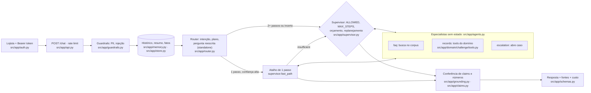
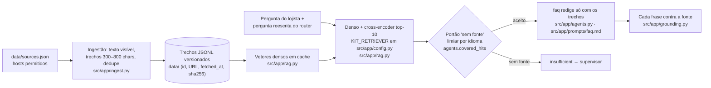
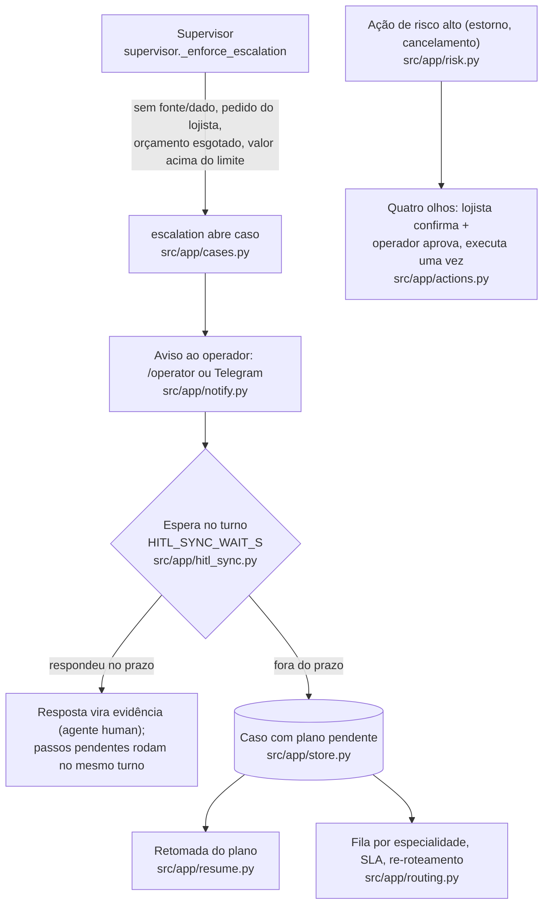

# Arquitetura (Getnet)

Três desenhos, cada caixa com o arquivo real que a implementa. Só descreve o que o código faz; números vêm de
`evals/results/` via `scripts/fill_readme.py` (README §0), nunca deste texto.

## 1. Agentes: router, supervisor e especialistas sem estado

- O router é o único que lê o histórico; os especialistas recebem a pergunta reescrita e o livro de fatos
  (`agents.llm_history`, [ADR 0007](adr/0007-especialistas-sem-estado.md)).
- Cada especialista devolve `AgentResult` com status `ok` / `partial` / `insufficient` / `error`
  (`src/app/schemas.py`); o supervisor lê o status e replaneja.
- Fluxo específico do domínio: `src/app/domain/challenge/flow.py`; tools com schema e dono verificado
  (`_lookup` só devolve registro do próprio `user_id`): `src/app/domain/challenge/tools.py`.

## 2. RAG: ingestão → armazenamento → busca → redação

- A busca é ação do especialista; o glossário expande a consulta (`agents.expand_query`).
- BM25 só entra quando a pergunta está no idioma do corpus (`rag.lexical_fits`); escolha do buscador feita antes do
  relógio ([ADR 0004](adr/0004-buscador-denso-com-teto-de-ram.md), [ADR 0008](adr/0008-considerado-e-nao-feito.md)).

## 3. HITL: humano só quando o sistema não resolve

- Resposta parcial só oferece o humano, sem abrir caso ([ADR 0006](adr/0006-humano-so-quando-nao-resolve.md)).
- Quem entrega a resposta do operador (turno ao vivo ou retomada) é decidido por carimbo gravado
  (`hitl_sync.live_owns`), sem corrida entre réplicas ([ADR 0002](adr/0002-replicas-mesmo-host.md)).
